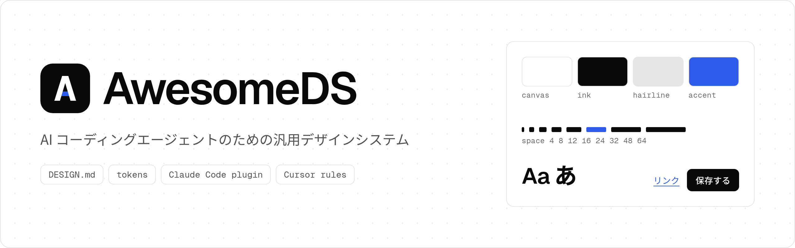

[日本語](README.md) | English

<p align="center">
  <picture>
    <source media="(prefers-color-scheme: dark)" srcset="docs/assets/brand/banner-dark.png">
    
  </picture>
</p>

<p align="center">
  <a href="#quick-start">Quick start</a> ·
  <a href="#skills">Skills</a> ·
  <a href="AwesomeDS/DESIGN.md">DESIGN.md</a> ·
  <a href="https://awesomeds.yumaker.studio">Demo site</a> ·
  <a href="https://design-thinking.yumaker.studio">Research plugin</a> ·
  <a href="Plugin/awesome-ds/">Plugin</a> ·
  <a href="CONTRIBUTING.md">Contributing</a> (Japanese)
</p>

# Awesome Design Systems

The source of truth for design, plus a plugin, for building front ends with AI coding agents (Claude Code, Cursor). At the center is **AwesomeDS**, a neutral, general-purpose design system.

White canvas, black text, a single accent color (`#2f5bea`), Geist + Noto Sans JP, a 4px grid, borders over shadows, short motion. Every value has a reason and a source.

## Three uses

AwesomeDS meets these three uses at the same time. The decision is STA-12.

| Use | What it does | Where it lives |
|---|---|---|
| 1. Apply the rules while building UI | Installing the plugin applies the AwesomeDS rules to the UI under construction | `awesome-ds` |
| 2. Make a design system for one product | Ask about the brand, then write that product's DESIGN.md and tokens | `ds-creator` |
| 3. Keep one general source of truth | Keep updating the shared answer for type, color, spacing, components, and motion | `AwesomeDS/` and `Knowledge/` |

Which phase ticket serves which use.

| Ticket | Use |
|---|---|
| STA-7, STA-13, STA-14, STA-16, STA-17 | 3. The source of truth |
| STA-8, STA-9, STA-15 | 1. Apply the rules. STA-9 and STA-15 also cover 2. A product-specific system |
| STA-18 | Not one of the three uses. Sir decides what becomes public |

When a choice splits, raise it to Sir.

## What is inside

| Location | Contents | Read first |
|---|---|---|
| [`AwesomeDS/`](AwesomeDS/) | The source-of-truth design system: DESIGN.md, tokens, 24 foundations, component conventions | [DESIGN.md](AwesomeDS/DESIGN.md) |
| [`Plugin/awesome-ds/`](Plugin/awesome-ds/) | Claude Code plugin (7 skills) and Cursor rules | [Plugin README](Plugin/awesome-ds/README.md) (Japanese) |
| [`web/`](web/) | A demo site where you can try AwesomeDS hands-on. The site itself is built with AwesomeDS. Served by Cloudflare Workers Static Assets, noindex. Production is https://awesomeds.yumaker.studio . Workers Builds comments the preview URL on each PR. workers.dev is https://awesomeds.yumaker.workers.dev . The Vercel project was paused on 2026-10-12 (rollback: docs/ops/cloudflare-rollback.md) | [SITE-DESIGN.md](web/SITE-DESIGN.md) (Japanese) |
| [`Knowledge/`](Knowledge/) | Sourced summaries of the skills, OSS, design systems, guidelines and articles we referred to | [Knowledge/README.md](Knowledge/README.md) (Japanese) |
| [`Reference/`](Reference/) | List of external links cited by Knowledge (auto-generated, do not edit by hand) | [REFERENCE.md](Reference/REFERENCE.md) |

## Quick start

Pick one that fits your goal.

### A. Install the plugin in Claude Code (recommended)

```
/plugin marketplace add Yu-aimaker/AwesomeDesignSystem
/plugin install awesome-ds@awesome-design-systems
```

Once installed, just ask for UI work, for example "build a settings screen", and the `awesome-ds` skill activates.

To try it from a local checkout:

```
claude --plugin-dir ./Plugin/awesome-ds
```

### B. Use it in Cursor

Copy `Plugin/awesome-ds/cursor/*.mdc` into `.cursor/rules/` in your project.

### C. Use it without the plugin

1. Copy `AwesomeDS/DESIGN.md` to your project root.
2. Load `AwesomeDS/tokens/tokens.css` and `tokens/tailwind.css` (for Tailwind v4).
3. Tell the agent "follow DESIGN.md".

### D. Run the demo site locally

```
cd web && pnpm install && pnpm dev
```

## Skills

| Skill | What it does | How to call it |
|---|---|---|
| `awesome-ds` | Applies AwesomeDS to the UI you are building. Wires the tokens, restyles shadcn/ui with them, and runs the pre-release checklist | Activates automatically on UI requests. To call it explicitly: `/awesome-ds:awesome-ds` |
| `ds-creator` | Interviews you about your product's brand one question at a time, then builds a product-specific DESIGN.md / tokens / preview on top of AwesomeDS | `/awesome-ds:ds-creator <product name>` |
| `design-verifier` | Captures real browser screenshots and adversarially checks DS compliance, brand fidelity and how it feels to a human, then writes a report | `/awesome-ds:design-verifier <URL>` |
| `design-thinking` | Improves UX with personas, user stories, journey maps, page flows and screen walkthroughs | `/awesome-ds:design-thinking <feature name>` |
| `knowledge-curator` | Adds entries to Knowledge, regenerates Reference, and proposes changes to AwesomeDS (for the weekly research) | `/awesome-ds:knowledge-curator` |
| `html-report` | Writes one HTML file: three-sentence conclusion, one table or figure, white canvas, dark text | Ask for a report or an HTML plan. Or `/awesome-ds:html-report` |
| `slides` | One 16:9 HTML file, one claim per slide. pptx only when the user asks for PowerPoint | Ask for slides. Or `/awesome-ds:slides` |

## AwesomeDS at a glance

```
canvas #ffffff  ink #0a0a0a  secondary #525252  muted #6b6b6b  hairline #e5e5e5  input border #8c8c8c
accent #2f5bea (links, focus, selection only)  primary button: white text on black
sans Geist + Noto Sans JP  mono Geist Mono  body 16px / 1.6 (Japanese 1.8)
spacing 4 8 12 16 24 32 48 64 96  radius 8 (controls) 12 (cards) 16 (dialogs)
motion 150-200ms cubic-bezier(.16,1,.3,1)  springs for gestures  reduced-motion supported
```

For details, see [AwesomeDS/DESIGN.md](AwesomeDS/DESIGN.md) and [AwesomeDS/foundations/](AwesomeDS/foundations/). Both are in Japanese.

## Repository layout

```
AwesomeDS/            Source-of-truth design system
  DESIGN.md           The one file agents read (Stitch DESIGN.md format + commentary)
  tokens/             tokens.css / tailwind.css / tokens.json (W3C DTCG format) + accents / radius-families / font-pairings
  data/               Measured data (brand colors of 261 companies, 24 curated palettes, 34 typefaces, 23-layer stack, OSS ranking)
  foundations/        24 topics: color, type, spacing, radius, depth, motion, layout, states, forms, dark mode, density, a11y and more
  components/         Component conventions and the pre-release checklist
  CHANGELOG.md        Change history (semver)
Knowledge/            Sourced findings, in per-category folders
Reference/REFERENCE.md  List of external links (generated by scripts/build-reference.mjs)
Plugin/awesome-ds/    Claude Code plugin (skills/, cursor/, ds/ = synced copy of AwesomeDS)
web/                  Demo site (Vite + React + Tailwind v4 + Motion + three.js + Lottie)
scripts/              Generation and validation (build-reference, extract-brands, build-palettes, build-fonts, fetch-repos, validate-*, hosting-smoke, preview-headers)
docs/ops/cloudflare-cutover.md  Cutover of production onto Cloudflare Workers, with the run record (2026-10-11 08:14 JST, 0 seconds of downtime)
docs/ops/cloudflare-rollback.md  Rollback from Cloudflare Workers to Vercel (DNS values and check commands)
.claude-plugin/marketplace.json  Plugin marketplace definition
.github/workflows/    Consistency checks + smoke tests of all routes, weekly data update on Monday 09:30 JST (deploys go through Cloudflare Workers Builds. Production is https://awesomeds.yumaker.studio , previews are PR comments. The Vercel project was paused on 2026-10-12)
```

## Update flow

1. `Weekly growth` (`.github/workflows/weekly-growth.yml`) runs Monday 09:30 JST (cron `30 0 * * 1`). A scheduled run opens a pull request. `weekly-growth-settle.yml` squash-merges `bot/weekly-growth` only when Check succeeded and every path is under `AwesomeDS/data/` or `Plugin/awesome-ds/ds/data/`. A manual `workflow_dispatch` stays a dry run and does not open a pull request. Candidates accumulate in `AwesomeDS/data/candidates.json` and are not shown on the site. The usage-billed automatic research job stays off. A person runs `knowledge-curator` for the written findings.
2. Add new findings to Knowledge with the `knowledge-curator` skill, then regenerate Reference with `node scripts/build-reference.mjs`. Actions do not call an AI API.
3. When there is evidence that AwesomeDS should change, update DESIGN.md / tokens / foundations and add the version to the CHANGELOG.
4. Sync the copy inside the plugin with `Plugin/awesome-ds/scripts/sync-ds.sh` and open a PR. CI checks consistency.

## Main references

[voltagent/awesome-design-md](https://github.com/voltagent/awesome-design-md), [kzhrknt/awesome-design-md-jp](https://github.com/kzhrknt/awesome-design-md-jp), [Leonxlnx/taste-skill](https://github.com/Leonxlnx/taste-skill), [shadcn/ui](https://ui.shadcn.com), [assistant-ui](https://github.com/assistant-ui/assistant-ui), Apple Human Interface Guidelines, Material Design 3, Duolingo Design, Nothing, Goodpatch, Linear, Vercel Geist, Stripe and others. All links are in [Reference/REFERENCE.md](Reference/REFERENCE.md).

## Brand assets

The icon and banner are in [`docs/assets/brand/`](docs/assets/brand/). The mark is a white "A" on a black tile, with only the crossbar in the accent color. The site's favicon uses the same mark.

## License

MIT. Statements about other companies' design systems are summaries of public information; the rights to each belong to its owner.
